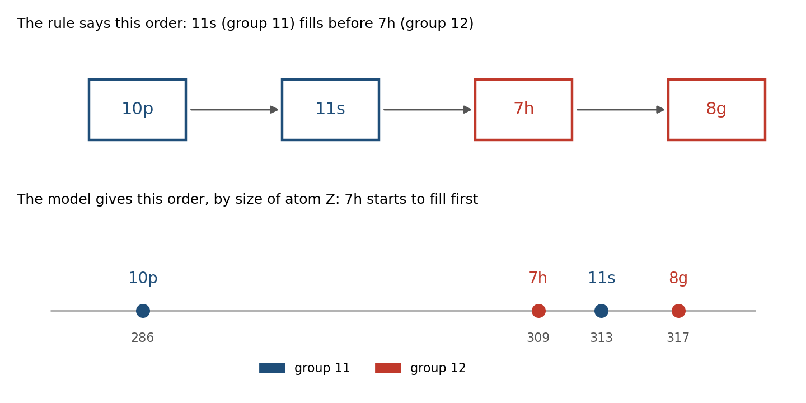
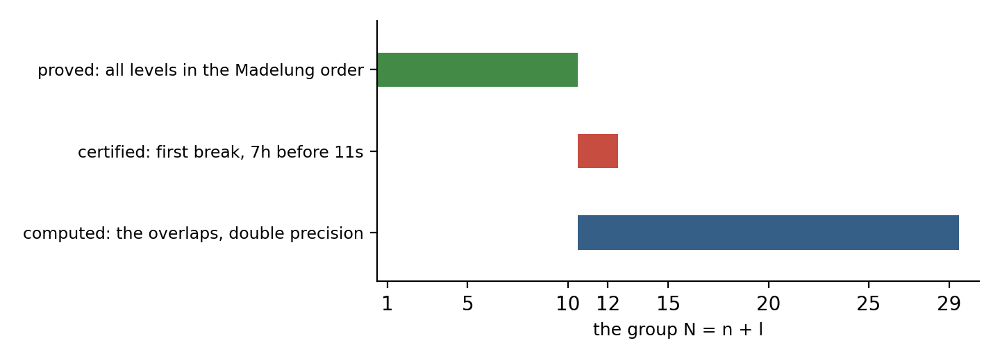

DOI of this text: [doi:10.5281/zenodo.24577158](https://doi.org/10.5281/zenodo.24577158)

This is an introductory text to the research paper *Where the $n+l$ rule breaks in the Thomas-Fermi atom: certified zero-energy thresholds, Madelung order through $n+l=10$, and the first overlap at $n+l=11$* [[Per26]](https://doi.org/10.5281/zenodo.24542256), by the same author. The paper has the proofs and the full computations. This note has the idea. No equations are needed to follow it. It makes no claim the paper does not make, and it says which claims are proved, which are certified by computer with error bars, and which are only computed.

One caution comes first, because the paper itself puts it first. This is about a **model**, the pure Thomas-Fermi model, and not about real atoms. An atom of size $Z = 310$ is far beyond any atom that exists. The question is a mathematical one: inside this model, how large must an atom be before a famous rule stops working?

# The rule, and a question it leaves open

Electrons in an atom sit in levels. Each level has two labels: a number $n = 1, 2, 3, \dots$ for the shell, and a letter for the shape of the orbit, $s, p, d, f, g, h, i$, which stand for $l = 0, 1, 2, 3, 4, 5, 6$. The **Madelung rule** says in which order the levels fill, and it has two halves.

- **First half.** Add the two labels, $N = n + l$. Levels with a smaller $N$ fill first. So $3p$ and $4s$ (both $N = 4$) fill before $3d$ ($N = 5$).
- **Second half.** Among levels with the same $N$, the one with the smaller $n$ fills first. In the row $N = 5$ the order is $3d$, then $4p$, then $5s$.

The rule works for almost every known element. But it is not a law of nature. It is a good pattern, and a good pattern can have an end. The question of this paper is exactly where.

# The Thomas-Fermi model

The **Thomas-Fermi** model is the classical statistical picture of the electrons of a heavy atom: the electrons form a cloud around the nucleus, and each electron feels the nucleus and the cloud together. It is the leading-order picture of a very large atom, and a recent theorem of Bjerg, Fournais, Hearnshaw and Solovej [[BFHS25]](https://arxiv.org/abs/2506.14227) shows that for large enough atoms it does not agree with the Madelung rule. Their result is about the limit of infinitely large atoms. It shows that the rule must fail somewhere. It does not say for which atoms, for which levels, or by how much.

In this model, the cloud has a special property: the energy at which electrons are just free is zero. So a level that reaches **zero energy** as the atom grows is a level that is just about to start to fill. For each level $(n, l)$ there is a size of atom, a **threshold**, at which the level reaches zero energy. Two earlier papers of the same author [[Per26a]](https://doi.org/10.5281/zenodo.24522163) and [[Per26b]](https://doi.org/10.5281/zenodo.24533673) studied a simpler model in which all levels of a group with the same $N$ have exactly the same threshold, and showed how a small change splits each group with the smaller $n$ first. That says what happens inside a group. It says nothing about what happens between groups, and it needs the groups to stay apart. This paper asks whether they do.

{width=88%}

# What is proved: the order holds up to $N = 10$

The first result, called Theorem A in the paper, is that the thresholds of all 30 levels with $N \le 10$ are in **exactly the Madelung order**: smaller $N$ first, and smaller $n$ first inside a row. This is **proved**, with the help of a computer that works with interval arithmetic, a way of computing in which every number is carried together with a rigorous band of error. Nothing here is a guess from a decimal that happens to look right. For the largest of these levels, $10s$, the atom size is between $236.65$ and $236.73$.

The method is worth a sentence. The paper does not try to find each threshold and compare. It brackets each threshold between two numbers that are certified, one below and one above, and then compares the brackets. If the brackets of two levels do not overlap, their order is proved. Counting how many times the wave of a level crosses zero gives the brackets, and an explicit estimate for the far end of the atom, where the cloud thins out like one over the distance cubed, makes sure that no crossing is missed out there.

# What is proved: the first break

The second result, Theorem B, is that the first break of the rule is one single swap. The level $7h$ belongs to the row $N = 12$, so the rule says it should fill after $11s$, which belongs to the row $N = 11$. In the model it is the other way round. The level $7h$ starts to fill at an atom size between $309.01$ and $309.11$, and $11s$ at a size between $312.76$ and $312.86$. This is **proved** with the same certified brackets.

{width=88%}

Three more statements are proved with it. No row up to $N = 10$ reaches into the next. The row $N = 10$ against the row $N = 11$ is the tightest of them, with a margin of about $0.4$ percent. And the swap of $7h$ and $11s$ is the **only** one among all levels below $8g$. So below that point the rule holds in full, with that one exception, and the first break is exactly this pair. The margin of the swap itself is small, $0.8$ percent in the threshold.

# Beyond the first break

After the first break, the paper does not claim proofs but numbers. These are **computed**, in ordinary double-precision arithmetic, and they are labelled so in the paper.

A table of the thresholds of 240 levels, all of those with $N \le 30$, shows that the rows overlap for every $N$ from $11$ to $29$: some level of row $N + 1$ lies below the top of row $N$. The overlap grows slowly with $N$.

{width=88%}

A second piece, a semiclassical argument, explains why the first overlap is at $N = 11$ and not earlier or later. In it, the room between rows shrinks like one over $N$, while the spread of the levels inside a row tends to a fixed fraction, about a quarter. The two curves cross a little below $N = 11$. The paper says plainly that this is a derivation at the level of physics, **not a theorem**. It matches the table, though: the predicted value for the size of $11s$ is $312.0$, against the certified $312.8$.

A third check follows the levels along a path from the earlier simpler model to the Thomas-Fermi field. Along that path the first overlap of rows $N = 11$ to $16$ switches on one after the other, the larger $N$ earlier. It is again a computed result. It shows that the overlap appears gradually as the field moves from the simple model to the Thomas-Fermi field.

# How special is the answer?

The paper tests how fragile the orders are. These are numerical tests, in double precision.

- Filling the levels by their actual energies, at the actual size of atom, gives the same order as the thresholds. In this way $7h$, $11s$ and $8g$ fill at $Z = 310, 314, 318$.
- A small correction for the electrons repelling each other, the factor $(Z-1)/Z$ of Fermi and Amaldi, moves every threshold by about one and a half units in $Z$ and changes no order.
- A field with the true long tail of a real atom, the minus one over distance tail, behaves quite differently. Every level then has infinitely many bound states, zero energy is no longer a threshold, and levels get out of order much earlier, from $N = 3$ to $N = 7$ depending on the field.

So the paper does **not** claim that the certified margins are robust under such corrections. The answer, $N = 11$ and the pair $7h$, $11s$, is the answer for the pure Thomas-Fermi field, and for no other.

The paper also compares the model with nature, as a sanity check. For 19 subshells whose first appearance in a real element is known, the model's sizes have a rank correlation of $0.9965$ with the real ones, and a median error of $13$ percent. This is **computed**, and the paper itself notes that simple counting does better. The point is only that the model is not nonsense, not that it predicts elements.

{width=85%}

# What was checked and how

The brackets come from interval arithmetic at 640 bits, with validated Taylor integration, a comparison of oscillation counts (Sturm comparison), and an explicit estimate of the tail. A second, independent program, written with a different arithmetic library, repeats the central checks for nine levels, including $7h$ and $11s$, and agrees. The double-precision table has an estimated error far below one part in a billion. The parts that rest on tables or on estimates are labelled so in the paper, and they are labelled so here.

# What this note does not claim

It does not say that real atoms break the Madelung rule at $Z = 310$, or at any size. The model is a one-body, non-relativistic, leading-order picture. It does not derive the number of electrons a level holds, the $2(2l+1)$, which is put in by hand. It does not claim that the margins survive a better model: the paper claims no robustness for them. It does not claim that the rule fails in the Thomas-Fermi atom in general, since the recent theorem [[BFHS25]](https://arxiv.org/abs/2506.14227) already points that way for large atoms. What is new is the **certified first failure**: its size, its pair of levels, and the proof that nothing breaks before it.

The paper also lists the older work on the question, including Klechkovskii, Latter, Abrahamson, Senatore and March, and ten Hoor. It says honestly which of them it could read in full and which only in abstract, and that numbers close to its own may already be in tables it did not see. Its novelty claim rests on the certificate and on the uniqueness of the first swap, and not on the numbers being unseen.

# Where to go next

- The paper itself [[Per26]](https://doi.org/10.5281/zenodo.24542256), with the proofs, the certificates and the scripts.
- The two earlier papers, on the four-sphere [[Per26a]](https://doi.org/10.5281/zenodo.24522163) and on the tie-break inside a group [[Per26b]](https://doi.org/10.5281/zenodo.24533673).
- The theorem for very large atoms [[BFHS25]](https://arxiv.org/abs/2506.14227).

# Use of AI {-}

Claude (Anthropic) was used in November 2026, under the author's direction, for drafting, figures and checks.

# Read the research paper {-}

```{=latex}
\raggedright
```

The full paper, with the proofs, is *Where the $n+l$ rule breaks in the Thomas-Fermi atom: certified zero-energy thresholds, Madelung order through $n+l=10$, and the first overlap at $n+l=11$*, by Michaël Perreault.

DOI: [doi:10.5281/zenodo.24542256](https://doi.org/10.5281/zenodo.24542256)

```{=latex}
\par\ifdim\dimexpr\pagegoal-\pagetotal\relax<15\baselineskip\ifdim\pagetotal>0pt\newpage\fi\fi
```

# References {-}

[BFHS25] A. Bjerg, S. Fournais, P. Hearnshaw and J. P. Solovej, *The angular momentum distribution of electrons in large atoms and its deviation from Madelung's rule*, 2025, [arXiv:2506.14227](https://arxiv.org/abs/2506.14227).

[Per26] M. Perreault, *Where the $n+l$ rule breaks in the Thomas-Fermi atom: certified zero-energy thresholds, Madelung order through $n+l=10$, and the first overlap at $n+l=11$*, 2026, Zenodo. [doi:10.5281/zenodo.24542256](https://doi.org/10.5281/zenodo.24542256).

[Per26a] M. Perreault, *The Demkov-Ostrovsky Madelung model as the circle-invariant conformal Laplacian of the round 4-sphere*, 2026, Zenodo. [doi:10.5281/zenodo.24522163](https://doi.org/10.5281/zenodo.24522163).

[Per26b] M. Perreault, *A first-order Madelung tie-break on the round four-sphere: Kelvin parity, convex order and the Thomas-Fermi field*, 2026, Zenodo. [doi:10.5281/zenodo.24533673](https://doi.org/10.5281/zenodo.24533673).
